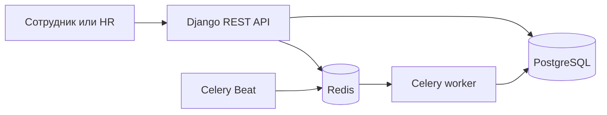

<div align="center">
  
  <br>
  
  
  
  
  <p><strong>Люди, смены и выплаты — в одном управляемом потоке.</strong></p>
</div>

TEAMFLOW — REST API для B2B-команд: сотрудники и отделы, ежедневная посещаемость, роли доступа и ежемесячный расчёт выплат. Инфраструктура для локального запуска собирается через Docker Compose.

## Карта системы



## Что умеет API

| Направление | Возможности |
|---|---|
| Команда | Отделы, профили, роли и основные оклады |
| Присутствие | Check-in, check-out и отметка опоздания |
| Выплаты | Месячный payroll с учётом рабочих дней и записей посещаемости |
| Доступ | JWT и правила для администратора, HR и сотрудника |
| Фоновые задачи | Celery worker и ежемесячное расписание Celery Beat |

## Маршруты

| Метод | Путь | Назначение |
|---|---|---|
| `POST` | `/api/v1/auth/token/` | Получить access и refresh токены |
| `POST` | `/api/v1/auth/token/refresh/` | Обновить access токен |
| `GET/POST` | `/api/v1/departments/` | Получить список или создать отдел |
| `GET/POST` | `/api/v1/users/` | Просмотреть или создать профиль |
| `POST` | `/api/v1/attendance/check_in/` | Зафиксировать начало рабочего дня |
| `POST` | `/api/v1/attendance/check_out/` | Зафиксировать окончание рабочего дня |
| `GET/POST` | `/api/v1/payrolls/` | Просмотреть или создать payroll |

Остальные операции доступны через стандартные маршруты `ModelViewSet`. Полная схема API и интерактивный Swagger: [`/api/docs/`](http://localhost:8000/api/docs/).

Для защищённых маршрутов передавайте токен в заголовке `Authorization: Bearer <access_token>`. Сотрудник видит только собственные записи; HR управляет данными команды, но не аккаунтами администратора.

## Месячный payroll

В первый день месяца в 00:10 по времени `Asia/Tashkent` Celery Beat запускает расчёт за предыдущий месяц. Основной оклад пропорционально умножается на долю посещённых будних дней. В расчёт рабочих дней входят понедельник–пятница, начиная с даты найма; праздничный календарь пока не подключён. Существующие записи payroll повторный запуск не перезаписывает.

## Быстрый запуск

```powershell
Copy-Item .env.example .env
```

Задайте в `.env` собственные `DJANGO_SECRET_KEY` и `POSTGRES_PASSWORD`, затем запустите:

```powershell
docker compose up --build
```

Compose поднимет Django API, PostgreSQL, Redis, Celery worker, Celery Beat и одноразовый сервис миграций. API будет доступен по адресу `http://localhost:8000`.

## Проверка

```powershell
python manage.py check
python manage.py test employees
```

В репозитории нет локальной базы, виртуального окружения и файла `.env`; настройки для Docker берутся из переменных окружения.
